## Hi there 👋


<!-- README-STATS:START -->

```
🕰️ I get my jam on during the daytime!

🌞 Morning  	4      commits	███░░░░░░░░░░░░░░░░░░░░░░░░░░░	5.63%
🌆 Daytime  	31     commits	██████████████████████████████	43.66%
🌃 Evening  	22     commits	█████████████████████░░░░░░░░░	30.99%
🌙 Night    	14     commits	█████████████░░░░░░░░░░░░░░░░░	19.72%
```

<!-- README-STATS:END -->

<!--
**daun-k/daun-k** is a ✨ _special_ ✨ repository because its `README.md` (this file) appears on your GitHub profile.

Here are some ideas to get you started:

- 🔭 I’m currently working on ...
- 🌱 I’m currently learning ...
- 👯 I’m looking to collaborate on ...
- 🤔 I’m looking for help with ...
- 💬 Ask me about ...
- 📫 How to reach me: ...
- 😄 Pronouns: ...
- ⚡ Fun fact: ...
-->
